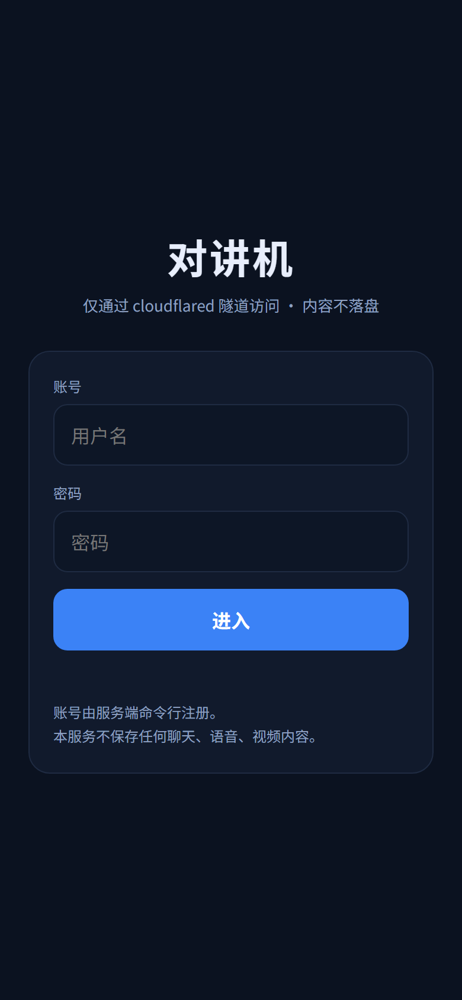
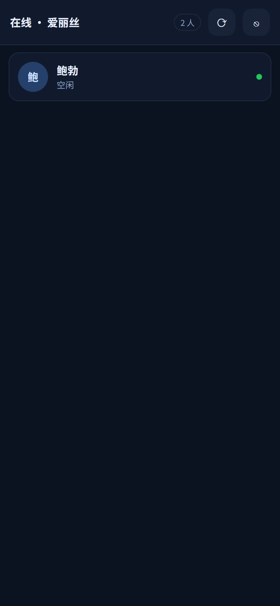
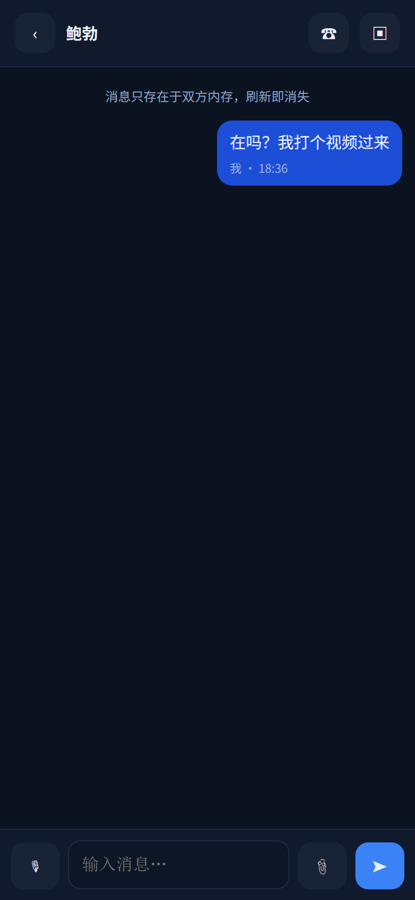
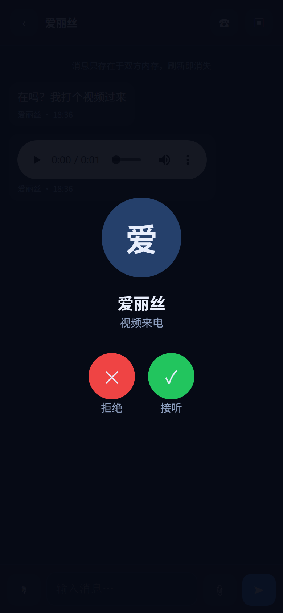
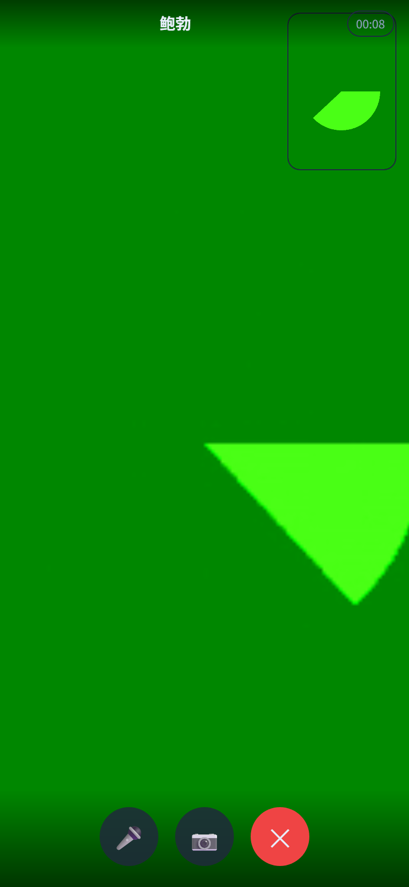
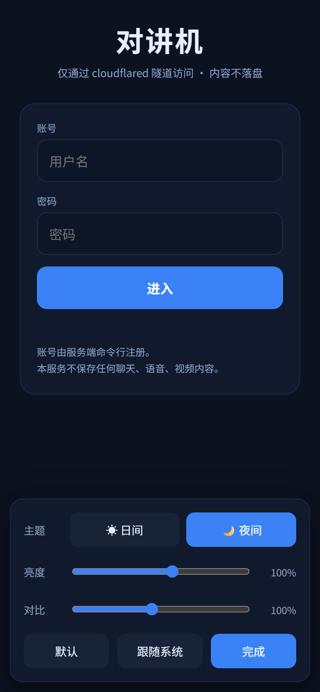
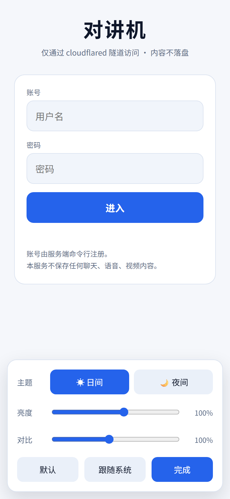

# 局域网对讲机（intercom）

> 私有仓库：<https://github.com/ycm50/intercom>（git push 需 GitHub 凭据）


零第三方运行时依赖的聊天服务器：C++20 + 单头文件 cpp-httplib + OpenSSL，全部静态链接，
一个 exe 加一个 `public/index.html` 就能跑。前端是纯 HTML + 原生 JavaScript，针对手机 Chrome 适配。



## 架构

```
手机 Chrome ──https──> Cloudflare 边缘 <──隧道插件──> cochat
   │                                                          │
   └────────── WebRTC 音视频（点对点，不过服务器）──────────┘
```

- 服务器只处理「谁在线、谁和谁通话、信令转发、文字/语音片段转发」。
- 语音通话、视频通话走 WebRTC 点对点直连，音视频数据完全不经服务器。
- 所有消息转发完立即释放，服务器**不写任何文件、不入库**；双方刷新即消失。

## 特性

| 能力 | 说明 |
| --- | --- |
| 密钥登录 | 账号由命令行注册，密码 PBKDF2-HMAC-SHA256 加盐存储，失败 8 次锁 2 分钟 |
| 文字消息 | 1:1 定向转发，不落盘 |
| 语音消息 | 按住/点击录制，MediaRecorder 编码为 opus/webm，base64 转发 |
| 视频片段 | 从相册选短视频发送，同样只在两端内存 |
| 语音通话 | WebRTC 点对点，服务端只转 SDP/ICE |
| 视频通话 | 前后摄像头、静音、关摄像头、本地小窗 |
| 日间 / 夜间 | 顶栏 ◐ 打开面板切换，两套完整配色（背景、气泡、输入框、按钮、通话界面全部跟随） |
| 亮度调节 | 面板内可调亮度 20–160%、对比度 60–150%，记忆到本地，支持跟随系统 |
| 访问控制 | 只监听 127.0.0.1，公网 IP 无法直连，且校验 Cloudflare 请求头 |
| 账号安全 | 同账号重复登录踢掉旧连接；来电 45 秒无人接听自动取消 |

## 安装

安装脚本不再联网下载，改为**以二进制文件为参数**：先读取文件头判断平台与架构，
与当前系统一致才安装，不一致直接报错并告诉你要用哪个文件。

### Linux / macOS

```bash
sh install.sh ./cochat-linux-amd64
```

### Windows

```powershell
.\install.ps1 .\cochat-windows-amd64.exe
```

两者都：

1. 读取二进制的 **ELF / PE / Mach-O 文件头**，识别出 `系统/架构`；
2. 与当前系统的 `uname -m` / `PROCESSOR_ARCHITECTURE` 比对，**不匹配就退出**（退出码 1），
   并提示当前系统应该用哪个文件；
3. 匹配则安装到 **`~/.local/bin/cochat`**（Windows 为 `%USERPROFILE%\.local\bin\cochat.exe`）；
4. 检查 PATH，Windows 会自动加入用户 PATH，Linux 给出提示命令。

可覆盖的环境变量：

| 变量 | 作用 |
| --- | --- |
| `COCHAT_PREFIX` | 覆盖安装目录 |
| `COCHAT_FORCE=1` | 架构不匹配也强行安装（仅供排障） |

支持的二进制类型：ELF（x86 / amd64 / armv7 / arm64 / ppc64le）、
PE（x86 / amd64 / armv7 / arm64）、Mach-O（x86 / amd64 / armv7 / arm64）。

## 构建

服务端不依赖 OpenSSL，也不依赖 nlohmann/json：密码学（SHA-256 / HMAC / PBKDF2 / 安全随机数）
和 JSON 都是内置实现，因此在任何装好 C++20 编译器的平台上都能直接编译。

### Windows

```powershell
$env:UCRT_PATH = 'A:\msys64\ucrt64\bin'   # MSYS2 UCRT64（g++ / cmake / ninja）
.\build.ps1
```

产物 `build\cochat.exe` 为静态链接，只依赖系统 DLL（无需任何第三方 DLL）。

### Linux（本地 WSL 里交叉/原生构建，**绝不在 VPS 上编译**）

```bash
bash build-linux.sh dist      # 输出 dist/cochat-linux-amd64 等静态二进制
```

产出的静态二进制可直接拷到任意 amd64/arm64 Linux 上运行，目标机不需要编译器、不需要任何运行库。
本机装了什么交叉工具链就出哪些架构，没装的会打印"跳过"而不是失败。

### 内建隧道插件（可插拔，需要 OpenSSL）

隧道不再是外部 `cloudflared.exe` 子进程，而是编译成一个**动态库**，主程序运行时按名字加载：

| 平台 | 插件文件 | 主程序 |
| --- | --- | --- |
| Windows | `cochat-tunnel.dll` | `cochat.exe` |
| Linux | `libcochat-tunnel.so` | `cochat` |

为什么拆成动态库而不是编进主程序：

1. **隧道要 OpenSSL，而主程序的核心承诺是零第三方依赖。** 拆出去以后，不装 OpenSSL 的人照样能用完整功能，只是没有隧道；`cmake` 找不到 OpenSSL 时会自动跳过插件目标，主程序照常构建。
2. **"插件缺失"必须是一个运行期状态。** 可能没编出来、可能被杀毒软件拦下、可能版本不符 —— 编译期内建表达不了这几种情况，运行时加载可以，而且失败只表达成"没有隧道"，`/api/info` 会写明原因。

插件实现的是 Cloudflare Tunnel 协议本身（capnp RPC 控制流 + 自写 HTTP/2 服务端 + TLS + 请求转发），不依赖任何外部可执行文件。运行：

```powershell
cochat --tunnel                     # quick 隧道，自动申请 *.trycloudflare.com
cochat --tunnel-token <连接令牌>     # 命名隧道（Cloudflare 控制台里那个 base64 串）
```

插件放在主程序同目录（`cmake --build` 会自动复制过去）。加载顺序：

1. `exe` 同目录
2. `exe` 同目录下的 `plugins/`
3. 环境变量 `COCHAT_TUNNEL_LIB` 指定的完整路径

排障：`COCHAT_TUNNEL_LOG=3` 打开隧道全部日志（默认只打 error/warn，健康隧道不输出任何东西）。

### 单元测试（可选，需要 OpenSSL）

默认**不**编译测试，也**不**依赖 OpenSSL——这是刻意的：对外承诺是"装好 C++20 编译器就能构建"。
只有想跑测试时才显式打开：

```powershell
# Windows
$env:UCRT_PATH = 'A:\msys64\ucrt64\bin'
$env:PATH = "$env:UCRT_PATH;$env:PATH"
cmake -S . -B build -G Ninja -DCMAKE_BUILD_TYPE=Release `
      -DCMAKE_C_COMPILER="$env:UCRT_PATH\gcc.exe" `
      -DCMAKE_CXX_COMPILER="$env:UCRT_PATH\g++.exe" `
      -DCOCHAT_BUILD_TESTS=ON
cmake --build build
ctest --test-dir build --output-on-failure
```

```bash
# Linux
cmake -S . -B build -G Ninja -DCMAKE_BUILD_TYPE=Release -DCOCHAT_BUILD_TESTS=ON
cmake --build build && ctest --test-dir build --output-on-failure
```

| 测试 | 验什么 |
| --- | --- |
| `crypto` | 内置 SHA-256 / HMAC / PBKDF2 与 OpenSSL **逐字节一致**（密码哈希不能有"差不多对"） |
| `json` | JSON 往返：ICE 配置就是这么读进来的 |
| `ops` | 进程名识别与实例自述：`--res` 不能误认 pid、不能杀错进程 |

### 持续集成（`.github/workflows/build.yml`）

`push` 到 `main`、提 PR、或手动触发都会跑。顺序是刻意排的：

```
test ──┬─> build × 4 架构 ──┐
       └─> install-scripts ─┴─> release（仅手动填了 tag 时）
```

- **test**：原生构建 + `ctest`；之后再编一份**不带测试**的默认构建，确认它没有引入 OpenSSL（守住零依赖承诺）。
- **build**：4 个架构交叉编译，每个产物都要过 `file` 校验（类型/架构对不对）和 `ldd` 校验
  （Linux 必须是 `not a dynamic executable`）。"编出来能跑但架构不对"是最常见的交叉编译事故，发布前挡住。
- **install-scripts**：用真实产物跑一遍 `install.sh`，确认装到自定义前缀。
- **release**：只有手动触发并填了 `tag` 才会创建 tag 与 Release，平时只出 artifact。

**发布是可覆盖的。** 同名 tag / release 已存在时，会把它们更新到本次构建的提交，
而不是像以前那样因为"tag already exists"整个 job 红掉。想重发同一个版本号
（修完问题、重新打包）直接再点一次、填同样的 tag 即可：

| 情况 | 结果 |
| --- | --- |
| tag 不存在 | 新建 tag 与 release |
| tag 已存在、release 不存在 | tag 被 force 更新到本次提交，再建 release |
| 两者都已存在 | tag 更新，旧 release 删除后按本次产物重建（旧资产一并清掉） |

> 注意：覆盖 tag 会改写它指向的提交。已经有人按旧 tag 拉过代码时，
> 他们的本地 tag 不会自动更新，需要 `git fetch --tags --force`。

## 账号存储策略（`~/.intercom/<userid>.json`）

每个账号一个独立文件，默认放在 **用户主目录下的 `.intercom`**：

- Windows：`C:\Users\<你>\.intercom\alice.json`
- Linux：`/root/.intercom/alice.json`

文件里**没有明文密码**，只有服务端加盐后的哈希：

```json
{
  "version": 1,
  "user": "alice",
  "display": "爱丽丝",
  "salt": "484d4df37bea1cf5692f0476adb84510",
  "hash": "5e9f0989650ad4858d6349723d31e2f77e440052955bf36b45255868a5529a2f",
  "iterations": 210000,
  "created_at": 1794314325,
  "last_login": 0,
  "algo": "pbkdf2-hmac-sha256"
}
```

- `salt` 由服务端用安全随机数（16 字节）生成，**每个账号都不同**；
- `hash` = PBKDF2-HMAC-SHA256(密码, salt, 210000 轮, 32 字节)，十六进制；
- 登录时**现场读取该用户的文件**、用文件里的盐重新计算并做恒定时间比较，所以手工改文件立即生效，无需重启；
- 改密码会**重新生成盐**，旧盐不会复用；
- 连续 8 次密码错误锁定 2 分钟（仅内存计数，重启清零）。

## 命令行管理账号

```powershell
# 注册：用户名 密码 [--display 展示名]
cochat.exe --add alice 123456 --display 爱丽丝

# 省略密码时从标准输入读取（密码里可以有空格）
cochat.exe --add alice

# 改密码：服务端重新加盐并保存，明文不落盘
cochat.exe --passwd alice 654321
cochat.exe --passwd alice            # 交互输入

# 核对密码：账号文件 + 运行中的服务两头都验（连不上服务不算通过）
cochat.exe --passwd --check alice 654321

# 改用户名（账号文件随之改名，密码与展示名保持不变）
cochat.exe --un alice 新名字

# 删除 / 列出
cochat.exe --del alice
cochat.exe --list        # 每行一个用户名，可直接管道处理
```

`--passwd` 的几条规矩：

| 命令 | 作用 |
| --- | --- |
| `--passwd` | 只报告账号库位置，不改任何东西 |
| `--passwd <用户>` | 交互输入新密码（不回显） |
| `--passwd <用户> <新密码>` | 直接改；密码里的空格、中文都可以 |
| `--passwd --check <用户> <密码>` | 只核对：文件里对不对 **+** 服务真的收不收 |
| `--passwd <用户> <过短的密码>` | 拒绝；确认要用就加 `--force` |

改完立即生效：服务按账号文件的修改时间热加载，不需要重启；在线会话需要重新登录。

`--list` 只输出用户名，一行一个：

```
$ cochat.exe --list
甲
乙
张三
```

### 用户名（ID）只能用 ASCII，密码不限

| 项目 | 规则 |
| --- | --- |
| 用户名 / ID | **只能用 ASCII 可见字符**：英文、数字、`_ - . ~ ! @ # $ % ^ & * ( ) + = [ ] { } \\ / : ; " ' , < > ?`；1–64 个字符，不能含空格和汉字 |
| 密码 | **不限**：中文、空格、符号都可以，1–512 字符 |
| 展示名 | 不限，可用中文 |

> 为什么 ID 不能是汉字：命令行参数在不同终端编码下容易对不上（`--del 乙` 会「用户不存在」），
> 用 ASCII 作为主键才可靠。展示名可以随便用中文，界面上显示的是展示名。

```powershell
cochat.exe --add alice "密码abc123" --display "张三丰"   # ID 英文，密码中文，展示名中文
cochat.exe --add bob "p@ss w#rd!" --display "鲍勃"
cochat.exe --add 乙 pass123456                          # 拒绝：ID 不能用汉字
```

用户名当文件名时会做**百分号转义**（ASCII 下其实就是原样），文件里的 `user` 字段保存原始 ID。

账号目录可用 `--accounts <目录>` 指定（默认 `~/.intercom`）；指定相对路径时按可执行文件所在目录解析。

## 运行

Windows：

```powershell
.\start.ps1          # 服务 + cloudflared 隧道一起启动
```

Linux 服务器（推荐）：

```bash
# 本地 WSL 构建后推送（产物是未压缩的静态二进制，不需要 gzip）
bash build-linux.sh dist
scp dist/cochat-linux-amd64 root@服务器:/tmp/
ssh root@服务器 "install -m 755 /tmp/cochat-linux-amd64 /opt/intercom/cochat"

# 服务器上安装为 systemd 服务
bash deploy/deploy.sh /opt/intercom
systemctl status intercom
```

装好之后日常操作都在服务器上用 `cochat --cur` / `cochat --res`，见
[运维手册](docs/运维手册.md)。

**服务器上不需要安装 g++ / cmake / make 等任何编译工具**，只跑静态二进制。

命令行注册的账号会被运行中的服务自动识别（按文件修改时间热加载），无需重启。

带内建隧道（推荐，不再需要 cloudflared）：

```powershell
.\build\cochat.exe --port 8080 --tunnel
```

注册完成后 `cochat --cur` 会显示公网地址（来源标记为 `[plugin]`）。

仍然可以用外部 cloudflared（对照排障时有用）：

```powershell
.\build\cochat.exe --port 8080
.\tools\cloudflared.exe tunnel --url http://127.0.0.1:8080
```

把 cloudflared 输出的 `https://xxx.trycloudflare.com` 发给对方，手机 Chrome 打开、输入账号密码即可。
想让 `--cur` 也看得到这个地址，启动服务时把地址一并告知（隧道重新建立后要重启服务并换新地址）：

```powershell
.\build\cochat.exe --port 8080 --tunnel-url https://xxx.trycloudflare.com
cochat.exe --cur                       # 现在能看到它了
```

| 截图 | 说明 |
| --- | --- |
|  | 登录后看到在线用户 |
|  | 文字 / 语音 / 视频消息 |
|  | 来电（震动 + 提示音） |
|  | 视频通话中 |
|  | 夜间主题与亮度调节 |
|  | 日间主题 |

## 查看 / 重启正在跑的实例（`--cur`、`--res`）

服务每次启动都会在 `~/.intercom/instances/<pid>.json` 写一份自述（端口、数据目录、
原始命令行、工作目录、启动时间），退出时删掉。`--cur` 与 `--res` 就靠它工作，
Windows 上没有 `/proc` 也能原样重启。

```powershell
# 本机所有实例 + 它们此刻的公网地址
cochat.exe --cur

# 只看某个数据目录的那个实例
cochat.exe --cur --data .\data

# 知道端口时直接连（老版本二进制没有自述文件时用这个）
cochat.exe --cur --data .\data --port 8080

# 重启 pid 最小的那个实例；systemd 托管的走 systemctl restart，
# 手工启动的按原命令行、原工作目录重放
cochat.exe --res
cochat.exe --res 12345
```

`--cur` 的输出长这样（一行一个实例，后面两行是数据目录与命令行）：

```
pid      端口 公网地址                                 状态
12345    8080  https://xxx.trycloudflare.com           已连接            [cli]
         数据目录 D:\intercom\data
         命令行  D:\intercom\cochat.exe --port 8080 --tunnel-url https://xxx.trycloudflare.com
```

- 关闭了隧道的实例显示「隧道已关闭」（`--no-tunnel`），配了但没连上显示「隧道未建立」；
- 进程没有任何自述文件、端口又连不上时，`--cur` 返回 1 并说明原因；
- `--res` 成功后最多等 20 秒，把新实例真正对外服务的地址打出来；
  旧地址这一刻已经失效，打印它等于把人引到死链上。

更完整的日常排障场景（发地址、重启、核对密码、发版本、看排障面板）见
[运维手册](docs/运维手册.md)。

## 命令行参数

| 参数 | 说明 |
| --- | --- |
| `--port <端口>` | 监听端口，默认 8080 |
| `--bind <地址>` | 监听地址，默认 127.0.0.1 |
| `--allow-lan` | 允许局域网直连（默认关闭；外部来源仍会被 403） |
| `--data <目录>` | 数据目录，默认 exe 同级 `data`（只放账号与可选 ice.json） |
| `--public <目录>` | 前端目录，默认 exe 同级 `public` |
| `--tunnel` | 启用内建隧道插件（quick 隧道；未编插件时只是没有隧道，不影响服务） |
| `--tunnel-token <令牌>` | 命名隧道的连接令牌；给了它自动启用隧道 |
| `--tunnel-url <地址>` | 记录对外公网地址（外部 cloudflared 场景用），`--cur` 与前端登录页会显示它 |
| `--no-tunnel` | 明确声明没有隧道（`--cur` 显示「隧道已关闭」） |
| `--force` | 配合 `--passwd`：接受过短的密码（默认拒绝） |
| `--cur` | 列出正在运行的实例及公网地址 |
| `--res [pid]` | 重启实例；不给 pid 时重启 pid 最小的那个 |
| `--passwd ...` | 见上文「命令行管理账号」 |
| `--help` / `-h` | 显示完整帮助 |

## 可选：自定义 ICE（NAT 穿透更稳）

`data/ice.json`：

```json
{
  "iceServers": [
    { "urls": "stun:stun.cloudflare.com:3478" },
    { "urls": "turn:你的TURN:3478", "username": "user", "credential": "pass" }
  ]
}
```

前端启动时通过 `/api/info` 获取。默认用 Cloudflare 与 Google 的公共 STUN，
同一网络/普通 NAT 下可直连；对称 NAT 需要自备 TURN。

## 源码结构

| 文件 | 作用 |
| --- | --- |
| `src/main.cpp` | HTTP 路由、WebSocket 会话、登录鉴权、通话与消息转发 |
| `src/hub.h/.cpp` | 在线用户与 1:1 房间（纯内存） |
| `src/auth.h/.cpp` | 账号库与 PBKDF2 校验、失败锁定 |
| `src/cert.h/.cpp` | 可选的 OpenSSL 自签名证书 |
| `src/util.*`、`src/json.h` | 编码、时间、文件、JSON 封装 |
| `src/instances.h/.cpp` | 实例自述（`~/.intercom/instances/<pid>.json`）与 `--cur` |
| `src/restart.h/.cpp` | `--res`：systemd 走 unit 重启，手工启动的按原命令行重放 |
| `src/passwd.h/.cpp` | `--passwd`：改密 / `--check` 双端核对 |
| `public/index.html` | 手机端单页前端（HTML + JS） |
| `plugins/tunnel/` | 内建隧道插件（capnp / HTTP/2 / TLS / 请求转发），独立动态库 |
| `src/tunnel/` | 插件 ABI 头与主程序侧加载器（不含 OpenSSL，加载失败只降级） |
| `tests/` | 单元测试（`-DCOCHAT_BUILD_TESTS=ON` 时才编译） |
| `docs/运维手册.md` | `--cur` / `--res` / `--passwd` 的日常用法与排障顺序 |

## 数据边界

服务器内存中只有：在线用户表、1:1 房间配对、待接来电、登录 token。
消息体转发后立即释放；账号目录 `~/.intercom/` 里每个账号一个文件，只有用户名、展示名、盐和密码哈希。

进程自述另放在 `~/.intercom/instances/<pid>.json`：端口、数据目录、原始命令行、工作目录、
启动时间、对外地址。它不含任何账号或密码信息，退出时删除，`--cur` / `--res` 靠它工作。

## 测试

分两层，职责不同，都别混着跑：

| 层 | 命令 | 特点 |
| --- | --- | --- |
| 单元测试 | `ctest --test-dir build` | 秒级、无网络、无外部进程；任何时候都可以反复跑 |
| 端到端测试 | 见 [TESTS.md](TESTS.md) | 真起服务、真开浏览器、真走隧道；耗时长，按需跑 |

单元测试是 `-DCOCHAT_BUILD_TESTS=ON` 时才会编进来的那三个（见上文"单元测试"），
端到端测试的脚本统一放在仓库外的 `../tmpscripts/`，不随仓库分发。

新增/修改功能时只跑受影响的那一项；改动涉及协议、账号或服务启动流程时再跑全量。